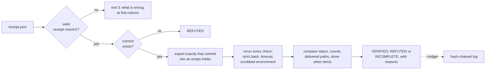

# receipt-checker

`receipt-check` checks an AI coding agent's "done" claim. It reruns the
claim's checks from the exact commit, in a clean copy, and refuses the claim
unless it reproduces.

Version 0.1.0 runs on Linux and macOS. It needs Node.js 20 or later, git and
bash, and has no dependencies. It is source-available under FSL-1.1-MIT, not
open source; see [License](#license). The picture version of this page is
[README.html](README.html).

## Why

When a coding agent finishes, it reports something like:

> PASS at commit abc123: 10 tests passed, 0 failed; delivered these files.

That sentence is easy to write and hard to check. The tests may have passed
because of a file that was never committed. The commit may not exist. "10
passed" may come from an earlier run, or from a summary that counted
something else. A reviewer who reruns the tests in their own checkout can be
fooled the same way, because that checkout has its own untracked files,
uncommitted edits and settings.

`receipt-check` takes the claim as a structured receipt and accepts it only
when a rerun that nothing outside the commit can touch produces the same
evidence. When evidence is missing or can't be read, the answer is
INCOMPLETE, never VERIFIED.

## How it works



1. **Read the receipt strictly.** Duplicate keys, unknown keys, comments and
   trailing commas are errors. Every problem is reported at once, with its
   line and column, and a misspelt key gets a suggestion.
2. **Find the commit.** The receipt names a full commit id. A branch, a tag
   or a short id can point somewhere else later, so they are refused. An id
   that is not in the repository is REFUTED. In a shallow clone, where the
   commit may just not have been fetched, it is INCOMPLETE.
3. **Export exactly that commit.** Its files are written byte for byte, with
   their executable bits and symlinks, into a new empty folder that has no
   `.git` and no history. Untracked files, uncommitted edits and anyone
   else's working tree can't reach it. The files come straight from git's
   object store rather than from `git archive`, because `git archive` obeys
   the commit's own `.gitattributes`: `export-ignore` would let a commit hide
   a failing test from the copy, and `export-subst` rewrites files.
4. **Rerun the checks**, in order and all of them, in that folder:
   - each with `bash -e -o pipefail -c`, so `false | cat` fails;
   - each with a timeout, 600 seconds unless the receipt sets another;
   - with an environment rebuilt from nothing: the absolute entries of
     `PATH`, a fresh empty `HOME` and `TMPDIR`, a fixed locale and time zone,
     no git settings or repository from around the copy, and only the
     variables the receipt declares;
   - in a process group of its own, stopped with SIGTERM and then SIGKILL
     when the check ends or times out, so nothing it started keeps running;
   - with `--offline`, in a network namespace of its own with no network
     (Linux only).
5. **Compare the claim with the evidence.**
   - Status: the receipt says PASS, so any failing check refutes it.
   - Counts: for a TAP or JUnit XML check, passed, failed and skipped are
     counted from the report the rerun produced, and must equal the claim.
   - Delivered paths: each must exist at the commit.
   - Done-when items: each names the check that proves it, and is met only
     if that check passed.
6. **Decide.** Any refuted claim makes the verdict REFUTED. Otherwise,
   anything that couldn't be checked makes it INCOMPLETE. Only a receipt
   whose every claim was confirmed is VERIFIED.

## Install

You need Node.js 20 or later, git and bash.

```sh
npm install -g github:keeganarko/receipt-checker
receipt-check --help
```

Or run it from a clone:

```sh
git clone https://github.com/keeganarko/receipt-checker.git
cd receipt-checker
npm test
node bin/receipt-check.js --help
```

It is not published to the npm registry.

## A one-minute example

Make a repository with one test, and commit it:

```sh
mkdir demo && cd demo && git init -q -b main
cat > math.test.mjs <<'EOF'
import { test } from 'node:test';
import assert from 'node:assert/strict';
test('adds', () => assert.equal(1 + 1, 2));
test('divides', { skip: 'not written yet' }, () => {});
EOF
git add math.test.mjs && git commit -q -m 'Add a test'
```

Write the receipt an agent would hand over, and verify it:

```sh
cat > receipt.json <<EOF
{
  "receipt": "receipt-check/1",
  "status": "PASS",
  "commit": "$(git rev-parse HEAD)",
  "checks": [{
    "id": "tests",
    "run": "node --test --test-reporter=tap math.test.mjs",
    "format": "tap",
    "counts": { "passed": 1, "failed": 0, "skipped": 1 }
  }],
  "delivered": ["math.test.mjs"],
  "done_when": [{ "id": "r1", "text": "the tests pass", "check": "tests" }]
}
EOF
receipt-check verify receipt.json
```

```text
receipt-check: exporting 93e09bbe16ce into a clean copy
receipt-check: running check "tests" (limit 600 s): node --test --test-reporter=tap math.test.mjs
VERIFIED: every claim in receipt.json held at 93e09bbe16ce
  ✓ commit 93e09bbe16ce exists
  ✓ the 1 delivered path exists at 93e09bbe16ce
  ✓ exported 1 file from 93e09bbe16ce into a clean copy: no .git, nothing uncommitted or untracked
  ✓ check "tests" passed: exit 0 in 0.1 s; TAP output shows 1 passed, 0 failed, 1 skipped, as claimed
  ✓ done-when "r1" (the tests pass) is met: check "tests" passed
  network: on (on Linux, --offline runs the checks without it)
```

Now claim a test that never ran:

```sh
sed -i.bak 's/"passed": 1/"passed": 2/' receipt.json
receipt-check verify receipt.json
```

```text
receipt-check: exporting 93e09bbe16ce into a clean copy
receipt-check: running check "tests" (limit 600 s): node --test --test-reporter=tap math.test.mjs
REFUTED: 2 claims in receipt.json did not hold at 93e09bbe16ce
  ✗ check "tests" claimed 2 passed, 0 failed, 1 skipped; its TAP output shows 1 passed, 0 failed, 1 skipped
  ✗ done-when "r1" (the tests pass) is not met: check "tests" failed
  ✓ commit 93e09bbe16ce exists
  ✓ the 1 delivered path exists at 93e09bbe16ce
  ✓ exported 1 file from 93e09bbe16ce into a clean copy: no .git, nothing uncommitted or untracked
  last lines of stdout from check "tests":
    |   ...
    | 1..2
    | # tests 2
    | # suites 0
    | # pass 1
    | # fail 0
    | # cancelled 0
    | # skipped 1
    | # todo 0
    | # duration_ms 84.97577
  network: on (on Linux, --offline runs the checks without it)
```

Last, the trap a rerun in your own checkout falls into: a test that passes
only because of a file that was never committed.

```sh
cat > config.test.mjs <<'EOF'
import { test } from 'node:test';
import { readFileSync } from 'node:fs';
test('reads the config', () => JSON.parse(readFileSync('config.json', 'utf8')));
EOF
echo '{}' > config.json
git add config.test.mjs && git commit -q -m 'Add a config test'
node --test config.test.mjs >/dev/null && echo 'passes here'
cat > receipt2.json <<EOF
{ "receipt": "receipt-check/1", "status": "PASS", "commit": "$(git rev-parse HEAD)",
  "checks": [{ "id": "config", "run": "node --test config.test.mjs" }] }
EOF
receipt-check verify receipt2.json
```

```text
passes here
receipt-check: exporting 3ab45479fb4e into a clean copy
receipt-check: running check "config" (limit 600 s): node --test config.test.mjs
REFUTED: 1 claim in receipt2.json did not hold at 3ab45479fb4e
  ✗ check "config" exited with 1
  ✓ commit 3ab45479fb4e exists
  ✓ exported 2 files from 3ab45479fb4e into a clean copy: no .git, nothing uncommitted or untracked
  last lines of stdout from check "config":
    |       at TestContext.<anonymous> (file:///tmp/receipt-check-b0BToX/copy/config.test.mjs:3:43)
    | …
    |     code: 'ENOENT',
    |     syscall: 'open',
    |     path: 'config.json'
    |   }
  network: on (on Linux, --offline runs the checks without it)
```

## The receipt

A receipt is one JSON object in the format `receipt-check/1`, read from a
file or from standard input (`-`). It is read strictly: duplicate keys,
comments, trailing commas, single quotes and leading zeros are errors, and
every problem is reported with its line and column.

| Key | Needed | Value |
|---|---|---|
| `receipt` | yes | `"receipt-check/1"` |
| `status` | yes | `"PASS"`. A receipt is a claim that the work is done. |
| `commit` | yes | The full commit id as `git rev-parse` prints it: 40 lowercase hex characters, or 64 in a SHA-256 repository. |
| `checks` | yes | 1 to 100 checks to rerun, described below. |
| `delivered` | no | Paths, relative to the repository root, that must exist at the commit. |
| `done_when` | no | What was promised, each item proved by a check. |
| `note` | no | Free text for people. It isn't checked. |

A check:

| Key | Needed | Value |
|---|---|---|
| `id` | yes | A name of up to 64 letters, digits, dots, dashes and underscores, starting with a letter or digit. |
| `run` | yes | The shell command. It runs at the root of the clean copy with `bash -e -o pipefail -c`. |
| `format` | no | `"exit-code"`, the default: only the exit status is checked. `"tap"` or `"junit"`: the test counts are checked as well. |
| `file` | no | For `tap` and `junit`, the report the command writes, relative to the root. Without it, the command's standard output is read. |
| `counts` | with `tap` or `junit` | `{ "passed": 10, "failed": 0, "skipped": 0 }`, all three even when one is 0. A PASS receipt can't claim failures. Not allowed with `exit-code`. |
| `timeout_seconds` | no | Whole seconds, 1 to 86400. The default is 600. |
| `env` | no | Variables the check needs, as `{ "NAME": "value" }`. Nothing else from your environment reaches the check except `PATH`. |

A done-when item has three keys, all needed:
`{ "id": "r1", "text": "the parser tests pass", "check": "tests" }`. Its id
follows the rule for check ids, and `check` names one of the receipt's
checks. The item is met when that check passes.

[examples/receipt.json](examples/receipt.json) is a complete receipt.
`receipt-check lint` checks a receipt without running anything:

```text
$ cat broken.json
{
  "receipt": "receipt-check/1",
  "status": "pass",
  "commit": "3f2c9e1",
  "checks": [
    { "id": "tests", "command": "npm test", "format": "tap" }
  ]
}
$ receipt-check lint broken.json
broken.json:3:13: status: write "PASS" in capitals
broken.json:4:13: commit: "3f2c9e1" is a short id; give all 40 characters (git rev-parse 3f2c9e1)
broken.json:6:22: checks[0].command: unknown key "command"; did you mean "run"?
broken.json:6:5: checks[0]: missing "run"
broken.json:6:5: checks[0]: missing "counts": format "tap" compares the passed, failed and skipped numbers you claim with the ones the rerun reports
broken.json: 5 problems; not a valid receipt-check/1 receipt
```

### How tests are counted

- **Leaf tests only.** A `describe()` block, a file or a suite is a group,
  not a test; the tests inside it are counted. A group that failed with no
  failing test inside it (a hook that threw, say) counts as one failure, so a
  failure is never lost.
- **TAP**, versions 13 and 14, with the indented subtests Node's test runner
  prints. A `# SKIP` or `# TODO` directive counts as skipped. Lines inside
  YAML diagnostic blocks are never read as tests. The stream has to account
  for every test: no plan, a plan that disagrees with the tests that ran,
  numbers out of order, or output that stops inside a subtest or a YAML block
  all give INCOMPLETE, because tests may be missing. `Bail out!` refutes the
  receipt.
- **JUnit XML.** Each `<testcase>` is a test. With `<skipped>` inside it is
  skipped; otherwise, with `<failure>` or `<error>` it failed. The summary
  attributes such as `tests=` and `failures=` are ignored, because nothing
  makes them add up. Comments and CDATA are never read as markup. A report
  that is cut short or isn't well formed gives INCOMPLETE.
- **Exit code only.** With `"format": "exit-code"` nothing is counted: exit 0
  passes and anything else fails.

## Verdicts and exit codes

| Exit | Meaning |
|---|---|
| 0 | VERIFIED: every claim reproduced. For `lint`, the receipt is valid; for `ledger`, the chain is intact. |
| 1 | REFUTED: at least one claim is false, such as a failing check, a count that differs, a missing path or a commit that doesn't exist. For `ledger`, the chain is broken. |
| 2 | INCOMPLETE: nothing was refuted, but something couldn't be checked, such as a timeout, a missing or unreadable report, a commit missing from a shallow clone, or `--offline` where it isn't available. |
| 3 | The receipt isn't valid `receipt-check/1`. |
| 4 | A usage or setup error, such as a `--repo` that isn't a git repository, or a ledger that couldn't be written. |
| 130, 143 | Stopped by SIGINT (Ctrl-C) or SIGTERM. The running check is stopped too. |

The text report marks each finding ✓, ✗ or ?, and ends with the verdict and
the reasons for it. `--json` prints the same result as one JSON object,
shortened here where it shows …:

```text
$ receipt-check verify receipt.json --json
{
  "tool": "receipt-check",
  "version": "0.1.0",
  "verdict": "VERIFIED",
  "exit_code": 0,
  "commit": "93e09bbe16ce9766c884bc123d4c1f26fecf04ae",
  "network": "on",
  "reasons": [
    { "code": "commit-found", "message": "commit 93e09bbe16ce exists" },
    { "code": "check-passed", "message": "check \"tests\" passed: exit 0 in 0.1 s; TAP output shows 1 passed, 0 failed, 1 skipped, as claimed" },
    …
  ],
  "checks": [
    {
      "id": "tests", "format": "tap", "exit_code": 0, "timed_out": false,
      "counts": { "passed": 1, "failed": 0, "skipped": 1 },
      "claimed": { "passed": 1, "failed": 0, "skipped": 1 },
      "outcome": "passed",
      …
    }
  ],
  …
}
```

`reasons` holds the findings that decided the verdict, and `findings` holds
every one. The object also has `receipt`, `delivered`, `done_when`, `copy`
and `ledger`.

`--keep` keeps the clean copy and prints where it is, for looking into a
check that behaved differently there.

## The ledger

`--ledger FILE` appends each verdict to a [JSON Lines](https://jsonlines.org/)
file. A line records the verdict, the commit, the SHA-256 of the receipt, the
reasons, the time, a sequence number and the hash of the line before it. Its
own `hash` is the SHA-256 of the rest of the line in canonical form, with the
keys sorted. Editing, removing or reordering a line breaks the chain, and
`receipt-check ledger FILE` names the line where it breaks. Appending to a
broken chain is refused.

```text
$ receipt-check verify receipt.json --ledger ledger.jsonl
…
$ receipt-check ledger ledger.jsonl
ledger.jsonl: 2 entries, hash chain intact; newest hash a046df1acac32957b02495acae0e70157747f7bea5786ecd0f2460cdbd029b4a
$ # change "VERIFIED" to "REFUTED" in the first line, then:
$ receipt-check ledger ledger.jsonl
ledger.jsonl: broken at line 1: that entry does not match its own hash (this entry was edited)
```

The ledger is tamper-evident, not tamper-proof. Anyone who can write the file
can rewrite it from the changed line onward, or replace it whole. To catch
that as well, keep the latest `hash` somewhere they can't write, such as a
commit, a CI log or a message.

## Know this before you run it

- **`verify` runs the commands in the receipt.** The clean copy and the
  rebuilt environment keep your working tree and your variables out of the
  check, but they are not a sandbox: a command can read and write anything
  your user account can. Read a receipt before you verify it, as you would a
  script.
- **A check proves only what it tests.** VERIFIED means the receipt's own
  checks reproduced at that commit, not that they are good checks. A receipt
  whose only check is `true` verifies.
- **Without `--offline`, checks have the network.** `--offline` needs Linux
  with unprivileged user namespaces (`unshare`), which some systems switch
  off. There, and on macOS, `--offline` gives INCOMPLETE rather than running
  with the network. Inside the namespace a check runs as root mapped to your
  own user, with only a loopback interface.
- **A process that leaves its process group**, with `setsid` for example, is
  not stopped when its check ends.
- **Submodules aren't exported,** so a commit that has them gives INCOMPLETE.
  Git LFS files are exported as the pointer files the commit holds.
- **Counts are of leaf tests,** and a runner's own summary can count
  differently: Node's `# pass` line does when a test has `t.test()`
  subtests. Claim the counts receipt-check reports; a mismatch shows both.
- **Size limits.** A receipt can be up to 1 MiB, a report file up to 64 MiB,
  and a report read from a check's standard output up to 32 MiB. Past those
  the report isn't read, and the verdict is INCOMPLETE.
- **Linux and macOS only.** `verify` needs bash and POSIX process groups. It
  doesn't run on Windows.

## What was verified

On 2026-10-15:

- `npm test`: 154 of 154 tests pass, none skipped, on Linux (WSL2) with
  Node.js 24.19.0 and 22.23.2, in about 11 seconds. They include end-to-end
  runs of the command in real temporary git repositories:
  - a true receipt is VERIFIED;
  - REFUTED: a check that fails at the commit, a commit that doesn't exist,
    inflated counts, and a check that passes only because of an untracked
    file, an uncommitted edit, or a failing test that `export-ignore` would
    have hidden;
  - INCOMPLETE: a timeout, a missing or unreadable report, and a commit
    missing from a shallow clone;
  - an edited, removed or reordered ledger line is found.
- The suite also passes in an empty environment (`env -i` with only `PATH`),
  the way `receipt-check` runs a check.
- `--offline` ran the checks with no network on WSL2, where unprivileged user
  namespaces work.
- CI runs the tests on Ubuntu with Node.js 20, 22 and 24 and on macOS with
  Node.js 24, prints the test counts, and verifies every receipt in
  `receipts/`.

## License

Copyright 2026 Keegan Choudhury. Licensed under the
[Functional Source License, Version 1.1, MIT Future License](LICENSE.md)
(FSL-1.1-MIT).

In plain words: you can read, use, change and share this code for any purpose
except a Competing Use. That means making it available to others in a
commercial product or service that substitutes for it (or for a product of
ours that uses it), or that offers the same or substantially similar
functionality. Two years after each version is released, that version is
also available under the MIT license. LICENSE.md has the terms that apply; this
summary doesn't replace them.

FSL is "Fair Source", not open source. This project calls itself
source-available.
